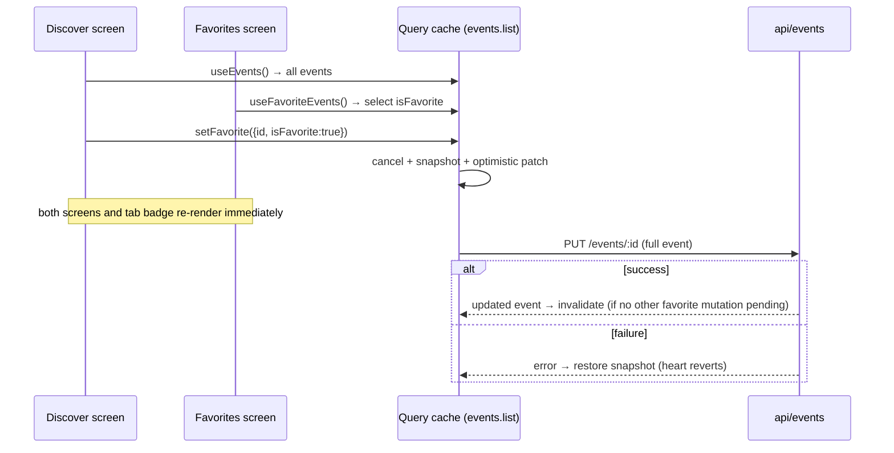

# feat: Evently — Discover and Favorites screens

## Overview

Turn the freshly scaffolded Expo template (tabs navigation) into "Evently", a two-tab event discovery app built from the provided Figma file. Discover lists events from a mockapi.io backend with a featured card, title search and category chips. Favorites lists saved events. Toggling a favorite persists via `PUT /events/:id` and stays in sync across both tabs, with an optimistic update and rollback.

## Problem Frame

This is a take-home interview task. It is evaluated on UI accuracy, React Native fundamentals, API and state management, code quality, and debugging. The template ships with an auth gate, a Profile tab and a NestJS-shaped API layer. None of these apply here: the task has no auth and only two screens. The plan therefore starts by removing the template's auth and profile flow, then builds the feature through the template's existing layering (`api` → `hooks/api` → components, TanStack Query for server state).

## Requirements Trace

- R1. Discover: fetch and display events from `GET /events`.
- R2. Discover: show the featured event (`isFeatured: true`) in a featured card.
- R3. Discover: case-insensitive search by title.
- R4. Discover: category filtering that works together with search.
- R5. Favorites: add and remove favorites, persisted through `PUT /events/:id`.
- R6. Favorite state is synchronized across Discover and Favorites.
- R7. Favorites counter updates dynamically (tab badge and the "N saved events" pill).
- R8. Follow the Figma closely: gradients, borders, shadows, overlapping date badge, spacing, typography.
- R9. Handle long titles, dynamic content and scrolling.
- R10. Loading (skeleton), empty and error states on both screens.
- R11. Correct safe-area handling.
- R12. Navigation between Discover and Favorites.
- B1 (bonus). Optimistic favorite update with rollback on failure.
- B2 (bonus). Retry for failed requests (Try again button, pull-to-refresh).
- B3 (bonus). Fallback for a missing or broken image.

## Scope Boundaries

- UI-only, no behavior: the location selector ("Berlin, Germany"), the notifications bell, the filter (sliders) button, and "See all".
- No event details screen. `GET /events/:id` is not needed by any screen and is not wired.
- No auth, no profile, no language picker UI. The app follows the device language among the existing `uk` and `en` locales.
- No dark theme. The Figma file defines a light palette only, so the app is locked to light.

## Context & Research

### Design source (Figma, read via Chrome on 2026-10-27)

The file has 7 frames: 5 phone screens (390×844), "Foundations" and "Components & states".

- **Screens:** Discover default; Discover loading (skeleton, with the date-badge placeholder still overlapping); Discover with search "Jazz" + Tech chip showing the "No events found" empty state with a "Clear search" button; Discover error ("Something went wrong / We couldn't load events. Please try again." with a "Try again" button carrying a refresh icon); Favorites ("My Favorites", subtitle, "♥ 3 saved events" pill, list of event cards).
- **Brand:** "Evently". The Discover tab label is **"Explore"** (compass icon). The Favorites tab label is "Favorites" (heart icon with a count badge).
- **Colors:** primary `#7254F3`, primary dark / text primary `#181930`, secondary text `#858998`, background `#F7F8FC`, surface `#FFFFFF`, border `#E9EAF1`, muted text `#6E7286`, favorite `#F04472`, favorite tint `#FEEBF0`, success `#25A77B`, success tint `#E3F5EE`, error `#D93A4A`, error tint `#FDECEE`, primary tint `#F0EDFE`. Chip-selected gradient: `#7254F3 → #8378FF`. Featured border gradient: `#7254F3 → #71C6FF`.
- **Typography:** Inter. Large heading 30/36 Bold; section heading 21/28 Semibold; event title 16/21 Semibold; body 14/20 Regular; caption 12/16 Medium; price 15/20 Bold.
- **Spacing (8 px system, 20 px screen padding):** 4, 8, 12, 16, 20, 24, 28, 40.
- **Radius:** badge 8, price 12, thumb/button 14, input 16, card 18, featured 20, panel 22, chip full.
- **Layout:** tab bar 50 + 34 safe area = 84, top radius 24, top shadow. Min touch target 44×44. Featured card height 190. List bottom inset 108.
- **Elevation:** `shadow.card` (y10, blur 22, 18%), `shadow.featured` (y14, blur 26, 45%), `shadow.primary` (y8, blur 18, purple 60%).
- **Icons:** outline, 24 px grid, 2 px stroke, round caps, Lucide-compatible (search, sliders, bell, map-pin, calendar, heart, heart-active, compass, chevron-down, x, ticket, cloud-alert, refresh, search-x).
- **FeaturedEventCard:** 2 px gradient border (135°), radius 22; image radius 20; overlay going from clear to 32%, purple 42% at 56%, 80% at 80%, near-black 94%; 44×44 favorite button; date badge (day + month) offset −10 top / −8 left, overlapping the card edge; category pill; title; location row; price pill.
- **EventCard:** height 120, thumbnail 96×96 radius 14, title at most 2 lines with ellipsis, heart is 32 visual with a 40 tap area, meta row (calendar date · map-pin location), price bottom-right. Price 0 renders a green "Free" pill. With no image, a primary-tint tile with a ticket icon and "EVENTLY".
- **Badges:** category tint per category (Tech purple, Music pink, Business amber, Sports blue), plus a dark "on image" variant used inside the featured card.
- **Upcoming list on Discover:** excludes the featured event (the list starts with "React Native Meetup").
- **No Favorites empty state is drawn.** It reuses the EmptyState component pattern (icon, title, message, action).

### API (probed on 2026-10-27)

`GET /events` returns 6 events with the shape `{ id: string, title, category, date: "2026-11-14T18:00:00" (no timezone), location, price: number, imageUrl, isFavorite: boolean, isFeatured: boolean }`. Categories are Tech, Music, Business and Sports. Exactly one event is featured (id 1). Event 6 has a deliberately long title. Event 4 has price 0.

### Relevant Code and Patterns

- The project rules in `CLAUDE.md` are authoritative: layer imports enforced by ESLint, `@/` alias, tokens only in components, `t()` for all strings in both `uk` and `en`, `makeStyles`, `ROUTES`, `ENDPOINTS`, `queryKeys`, named exports.
- `api/profile.ts` + `hooks/api/profile/useProfile.ts` + `hooks/api/profile/useUpdateProfile.ts` show the chain to mirror (they are removed in Unit 1, so copy the pattern first).
- `helpers/api/client.ts` (`http`), `helpers/api/errors.ts` (`ApiError`), `helpers/query-client.ts` (retry policy: no retry on 4xx, up to 2 retries otherwise).
- `components/shared/layout/{Screen,EmptyState,ErrorState,TabBarIcon}.tsx`, `components/shared/ui/{Text,Button,Input}.tsx`.
- `helpers/format/format-date.ts`, `helpers/format/format-price.ts`, and `helpers/format/format-price.test.ts` (test style).
- Jest preset `jest-expo`; `@testing-library/react-native` is already a dev dependency.

### Institutional Learnings

- None. The repo is greenfield and has no `docs/solutions/`.

## Key Technical Decisions

- **Server state lives only in TanStack Query.** A single list query (`queryKeys.events.list()`) is the source of truth. Favorites is a derived view of the same cache (`isFavorite === true`), so both tabs sync for free and the counter is just a derived length. No Zustand copy of events, per the project rules.
- **Favorite mutation takes the target value, not "toggle".** `setFavorite({ id, isFavorite })` makes rapid double taps idempotent and last-write-wins. Optimistic flow: `cancelQueries` → remember the target event's previous `isFavorite` → `setQueryData` patch of that one event → on error, revert only that event, and only if the cache still holds this mutation's optimistic value (never restore a whole-list snapshot, because that would also undo other in-flight toggles) → on settled, invalidate the list only when `isMutating({ mutationKey }) === 1`. The settling mutation still counts itself in TanStack Query v5, so `=== 0` would never fire. This keeps a mutation-triggered refetch from overwriting a newer optimistic state.
- **Favorite PUTs are serialized per event** with the TanStack Query v5 mutation `scope: { id: 'favorite-<eventId>' }`. Two quick taps on one heart then reach mockapi in order, so the server's final value matches the UI. Different events still save in parallel.
- **A failed toggle shows a short, non-blocking message** ("Couldn't update favorites") through a minimal `Toast` mounted once at the root. The toast is driven by a small client-state store (`store/toast.ts`), so no toast library is needed. Pull-to-refresh is disabled while a favorite mutation is pending. A focus refetch that lands mid-PUT can still flicker the heart briefly; this is accepted as a known limitation.
- **The PUT body is the full event with the new `isFavorite`.** mockapi's PUT semantics for partial bodies are not guaranteed, and sending the full object is correct either way. The mutation reads the current event from the cache.
- **Search and category filtering are client-side pure functions** in `helpers/events/`. The dataset is small, mockapi's `search` param matches across all fields (not just title), and pure functions are trivially testable. Filters apply to the whole list. The featured card is taken from the filtered result, so search and category hide it consistently, matching the "Jazz" empty-state frame. No debounce: filtering is in-memory and cheap.
- **Categories come from the data:** "All" plus unique categories in first-appearance order. This yields the Figma order (Tech, Music, Business, Sports) without hardcoding. Per-category badge colors are a token map with a neutral fallback for unknown categories.
- **The event type is a zod schema in `types/models/event.ts`, parsed in `api/events.ts`.** There is no Swagger, so `npm run api:types` cannot produce `schema.d.ts`. This deviates from the "types alias generated DTOs" rule, deliberately: it validates the external boundary and `z.infer` provides the type. `imageUrl` is optional or empty-tolerant so the image fallback has a real path. Because the mockapi project is public and writable by others, each item is checked with `safeParse`: invalid items are dropped and logged with `logger.warn`, and the query fails only when the payload is not an array.
- **Tab bar:** JS `Tabs` from `expo-router`, styled to Figma (white, top radius 24, top shadow, primary active tint, `tabBarBadge` with the favorite color). This deliberately deviates from the CLAUDE.md "NativeTabs" rule, because the design's custom tab bar (radius, shadow, badge color) cannot be matched by native tabs. Record this in the interview notes.
- **New libraries (all through `npx expo install`; a new development build is required):** `expo-linear-gradient` (featured border and overlay, chip gradient), `expo-image` (caching, `onError` for the fallback, transitions), `@expo-google-fonts/inter` + `expo-font` (Inter), `lucide-react-native` + `react-native-svg` (icons match the Figma "Lucide-compatible" set). This deviates from the `material-design-icons` rule in favor of design fidelity.
- **Tab bar layout:** the bar is `position: 'absolute'` so its rounded top corners float over content. Both tab screens use `Screen` with `edges={['top']}`. List bottom padding is the tab bar height plus the bottom inset plus spacing, computed rather than the fixed 108 from Figma.
- **Touch targets:** the card heart keeps its 32 visual size, and `hitSlop` brings the tap area to the 44×44 minimum (this overrides the Figma "tap area 40" note).
- **UI-only controls** (bell, filter, location, See all) give pressed feedback (opacity) and do nothing else. They carry an accessibility label.
- **Formatting locale** follows `i18n.language` (`en` → `en-GB`, `uk` → `uk-UA`), with currency EUR. The month in the date badge is uppercased; the card meta uses the short month as-is. Component tests run under `en`.
- **Keyboard:** lists use `keyboardShouldPersistTaps="handled"` and `keyboardDismissMode="on-drag"`. The search bar scrolls with the header (not sticky), as in Figma.
- **Theme:** rewrite `theme/tokens.ts` to the Figma palette, spacing, radius, typography, shadows and gradients, and lock to the light theme. Spacing keys stay `xs…` style names mapped to the Figma scale. The template components (`Button`, `Input`, `EmptyState`) are restyled through tokens rather than duplicated.
- **Remove the template's auth and profile flow entirely** (user decision). Root layout renders `(tabs)` directly.
- **Route structure follows template pattern A:** `app/(tabs)/(discover)/` (first tab as a group, so it is `/`) and `app/(tabs)/favorites/`, each with a headerless Stack `_layout` and an `index`. Sections are `discover` and `favorites`; the domain is `events`.

## Open Questions

### Resolved During Planning

- How to get design specs: read the Figma file in Chrome (5 screens + Foundations + Components sheets, captured above).
- What to do with auth/profile: remove it (user choice).
- Should the featured event appear in the Upcoming list? No. The Figma Upcoming list starts with event 2.
- Does search/category affect the featured card? Yes (user decision). Filters apply everywhere. The Figma "Jazz + Tech" frame is consistent with this but does not prove it, so it is an interpretation to mention in the interview.
- What should "Clear search" reset? Both the search text and the category (back to "All"). That is the only way out of an empty result for both filters.

### Deferred to Implementation

- Whether a Favorites card removal should animate. The default is Reanimated `itemLayoutAnimation` on the Favorites list if it is cheap; otherwise the card is removed instantly.
- Whether mockapi's PUT accepts partial bodies. This is moot because the full object is sent, but confirm the response shape on a real call.
- Pixel-level values not readable from the Figma overview screenshots (exact chip paddings, search bar height, tab bar shadow opacity). Re-open the Figma frames and compare during Unit 6/7 polish.
- `date` has no timezone. Format it as local time; confirm the "14 NOV" and "18 Nov" output on device.

## Output Structure

```
app/
  _layout.tsx                      (modified: no auth gate, load Inter)
  +not-found.tsx
  (tabs)/
    _layout.tsx                    (Explore / Favorites, styled tab bar, badge)
    (discover)/_layout.tsx
    (discover)/index.tsx
    favorites/_layout.tsx
    favorites/index.tsx
api/events.ts
types/models/event.ts
hooks/api/events/
  useEvents.ts
  useFavoriteEvents.ts
  useSetFavorite.ts
  useSetFavorite.test.tsx
helpers/events/
  filter-events.ts
  filter-events.test.ts
components/shared/
  ui/            Chip, Badge, PriceTag, IconButton, FavoriteButton, SearchInput, Skeleton, (restyled Button/Text/Input)
  events/        EventCard, EventImage, EventCardSkeleton (+ EventCard.test.tsx)
  layout/        Screen, EmptyState, ErrorState, TabBarIcon (restyled)
components/screens/
  discover/      DiscoverHeader, CategoryChips, FeaturedEventCard, FeaturedEventSkeleton, SectionHeader
  favorites/     FavoritesHeader
i18n/locales/{uk,en}/{common,discover,favorites}.json
theme/tokens.ts                    (Figma tokens)
```

`EventCard` is used by both sections, so it lives in `components/shared/` per the rule "a second section needs it → shared". It stays props-only, without data fetching.

## High-Level Technical Design

> *This illustrates the intended approach and is directional guidance for review, not implementation specification. The implementing agent should treat it as context, not code to reproduce.*



Discover derivation (pure): `events → filterEvents({query, category}) → { featured: first isFeatured, upcoming: rest without featured }`. Empty when both are empty.

## Implementation Units

- [ ] **Unit 1: Remove the template auth/profile flow and wire the API URL**

**Goal:** The app boots straight into tabs, with no login gate, no profile, and no dead auth code.

**Requirements:** R12 (foundation)

**Dependencies:** None

**Files:**
- Modify: `app/_layout.tsx`, `app/(tabs)/_layout.tsx`, `providers/AppProviders.tsx`, `helpers/api/client.ts`, `helpers/api/endpoints.ts`, `helpers/api/query-keys.ts`, `helpers/routes.ts`, `i18n/resources.ts`, `.env` (create from `.env.example`), `eas.json` (set `EXPO_PUBLIC_API_URL` per profile, or document EAS env)
- Delete: `app/(auth)/`, `app/(modals)/`, `app/(tabs)/profile/`, `components/screens/auth/`, `components/screens/profile/`, `hooks/api/auth/`, `hooks/api/profile/`, `api/auth.ts`, `api/profile.ts`, `store/auth.ts`, `types/forms/login.ts`, `types/models/user.ts`, `types/models/auth.ts`, `i18n/locales/*/auth.json`, `i18n/locales/*/profile.json`, `components/shared/forms/` (only the login form used it)
- Uninstall: `react-hook-form`, `@hookform/resolvers`, `expo-secure-store` (orphaned by the auth removal)
- Test: none (see below)

**Approach:**
- Drop `Stack.Protected`, `useRestoreSession` and the session-based splash hide. The splash now hides once fonts are loaded (Unit 2).
- Remove `setUnauthorizedHandler` and the bearer-token header from `http`. If that leaves `tokenStorage` unused, remove it; keep MMKV `storage` and `persistStorage` (used by `store/settings`).
- Keep `store/settings` (AppProviders reads `language`).
- Set `EXPO_PUBLIC_API_URL=https://6ae0a2fbbe3bc8fead979ee6.mockapi.io/api/v1` in both `.env` and the committed `.env.example`, because `.env` is gitignored and `config/env.ts` throws at import time when the variable is missing. Tests `jest.mock('@/api/events')` so they never load `config/env`.
- Hide the splash unconditionally after the first render. Unit 2 replaces this with "hide when fonts are `loaded || error`", so a font failure never leaves the splash up.

**Patterns to follow:** CLAUDE.md "Never" list; orphan cleanup only for code this change makes unused.

**Test expectation:** none. This is pure removal; lint (layer rule plus unused imports) and typecheck prove nothing still references the deleted modules.

**Verification:** lint, typecheck and existing tests pass; the app opens on the tabs with no login screen.

- [ ] **Unit 2: Design tokens, fonts, icons and native dependencies**

**Goal:** Put the Figma foundations into `theme/` and install the libraries the UI needs.

**Requirements:** R8, R11

**Dependencies:** Unit 1

**Files:**
- Modify: `theme/tokens.ts`, `theme/index.ts`, `providers/ThemeProvider.tsx` (force light), `app/_layout.tsx` (load Inter, hide splash on `loaded || error`), `app.config.ts` (`userInterfaceStyle: 'light'` if present), `package.json`
- Modify (restyle via tokens only): `components/shared/ui/Text.tsx` (Figma variants: heading, section, title, body, caption, price), `components/shared/ui/Button.tsx` (primary with `shadow.primary`, radius 14, optional leading icon), `components/shared/layout/EmptyState.tsx` (icon slot), `components/shared/layout/ErrorState.tsx` (refresh icon on the button, message plus description)
- Test: none (styling)

**Approach:**
- Tokens: colors (all Foundations swatches, including tints), `categoryColors` map (bg + fg per category plus a fallback), gradients (chip, featuredBorder, featuredOverlay stops), shadows (card, featured, primary as RN shadow + Android elevation pairs), spacing, radius, typography with `fontFamily` per Inter weight, layout constants (tab bar height, list bottom inset, featured card height, min touch target).
- Install through `npx expo install`: `expo-linear-gradient`, `expo-image`, `expo-font`, `@expo-google-fonts/inter`, `react-native-svg`, `lucide-react-native`. Then rebuild the dev client.

**Patterns to follow:** `theme/make-styles.ts`; the "no hex in components" rule.

**Test expectation:** none, because this is styling and config. It is verified visually in Units 6–7.

**Verification:** typecheck passes; the dev build launches with Inter rendering; no hex literals outside `theme/`.

- [ ] **Unit 3: Events domain: model, API, query hooks, favorite mutation**

**Goal:** A typed, validated data layer with a synchronized optimistic favorite toggle.

**Requirements:** R1, R5, R6, R7, B1, B2

**Dependencies:** Unit 1

**Files:**
- Create: `types/models/event.ts`, `api/events.ts`, `hooks/api/events/useEvents.ts`, `hooks/api/events/useFavoriteEvents.ts`, `hooks/api/events/useSetFavorite.ts`, `store/toast.ts`, `components/shared/ui/Toast.tsx`
- Modify: `helpers/api/endpoints.ts` (`EVENTS.ROOT`, `EVENTS.BY_ID(id)`), `helpers/api/query-keys.ts` (`events.all`, `events.list`)
- Test: `hooks/api/events/useSetFavorite.test.tsx`, `types/models/event.test.ts`

**Approach:**
- The zod `eventSchema` accepts an `imageUrl` that is missing or empty (normalized to `undefined`). `api/events.ts` checks each item with `safeParse`, drops invalid items with a warning, and throws only when the payload is not an array.
- The mutation uses `scope: { id: 'favorite-<eventId>' }` for per-event ordering. `onError` also pushes the toast message to `store/toast.ts`. `Toast` stays props-only, because the layer rule bars `components/shared` from importing `store`. `app/_layout.tsx` reads the store and renders it once.
- `useEvents` is a plain list query. `useFavoriteEvents` is the same query key with `select` filtering on `isFavorite`, which is what keeps the two tabs consistent.
- `useSetFavorite` implements the optimistic/rollback flow from Key Technical Decisions, with a shared `mutationKey` so `isMutating({ mutationKey })` can gate invalidation.

**Patterns to follow:** the removed `api/profile.ts` / `useProfile` / `useUpdateProfile` chain; `ENDPOINTS`, `queryKeys`.

**Test scenarios:**
- Happy path: with the cache seeded with events (id 2 not favorite), `mutate({id:'2', isFavorite:true})` flips the cache before the API resolves, and after success `api.update` was called with the full event and `isFavorite: true`.
- Happy path: the `useFavoriteEvents` selection includes id 2 right after the optimistic patch, and its count goes from N to N+1.
- Error path: the API rejects → id 2 reverts to not-favorite and the favorites count is unchanged.
- Error path (concurrent): mutations on id 2 and id 3 are in flight together and id 2 fails → id 2 reverts, while id 3 keeps its optimistic value.
- Edge case: two quick mutations on the same id (true then false) end with `isFavorite: false` in the cache, and invalidation runs only after the last one settles.
- Edge case: a mutation on an id missing from the cache does not crash and leaves the cache unchanged.
- Error path: on failure, a toast message is pushed to `store/toast`.
- Integration: two mutations on the same id run sequentially (the second PUT starts only after the first settles).
- Schema: a valid API item parses. An item with `imageUrl: ""` parses with `imageUrl` undefined. A list with one item whose `price` is a string returns the other items and drops that one. A non-array payload rejects.

**Verification:** tests pass; on device, toggling a heart persists across an app restart (it is refetched from the API).

- [ ] **Unit 4: Filtering and derivation helpers**

**Goal:** Pure, tested logic for search, category, the categories list, and the featured/upcoming split.

**Requirements:** R2, R3, R4

**Dependencies:** Unit 3 (the `Event` type)

**Files:**
- Create: `helpers/events/filter-events.ts`
- Test: `helpers/events/filter-events.test.ts`

**Approach:** `filterEvents(events, { query, category })` matches a trimmed, case-insensitive substring of the title, with `category === null` meaning All. `getCategories(events)` returns unique categories in first-appearance order. `splitFeatured(events)` returns `{ featured, upcoming }`, where featured is the first `isFeatured` and upcoming is everything else in API order.

**Patterns to follow:** `helpers/format/format-price.ts` + test.

**Test scenarios:**
- Happy path: the query "react" matches "React Native Meetup" (case-insensitive).
- Happy path: category "Tech" with no query returns ids 1, 2 and 6.
- Happy path: query "berlin" + category "Tech" returns only id 1. Id 2 matches "Berlin" only by location, so title-only search excludes it; id 5 is excluded by category.
- Edge case: a whitespace-only query behaves like an empty query.
- Edge case: the query matches location but not title ("Hamburg") → no result (title-only search).
- Edge case: "Jazz" + Tech → empty array.
- Happy path: `getCategories` on the API fixture returns `['Tech','Music','Business','Sports']`.
- Happy path: `splitFeatured` returns id 1 as featured and upcoming without id 1. With no featured item, featured is null and upcoming is the full list.

**Verification:** tests pass.

- [ ] **Unit 5: Shared UI components**

**Goal:** Reusable, props-only building blocks matching the Components sheet.

**Requirements:** R8, R9, R10, B3

**Dependencies:** Units 2, 3 (the `Event` type)

**Files:**
- Create: `components/shared/ui/Chip.tsx`, `components/shared/ui/Badge.tsx`, `components/shared/ui/PriceTag.tsx`, `components/shared/ui/IconButton.tsx`, `components/shared/ui/FavoriteButton.tsx`, `components/shared/ui/SearchInput.tsx`, `components/shared/ui/Skeleton.tsx`, `components/shared/events/EventCard.tsx`, `components/shared/events/EventImage.tsx`, `components/shared/events/EventCardSkeleton.tsx`, `components/shared/events/index.ts`
- Modify: `components/shared/ui/index.ts`
- Test: `components/shared/events/EventCard.test.tsx`

**Approach:**
- `Chip`: the selected state uses the gradient fill and white text; the unselected state is white with a border.
- `Badge`: category tint from `categoryColors` or the "on image" variant.
- `PriceTag`: price 0 shows "Free" (success tint), otherwise a formatted EUR value; variants for list and on-image use.
- `FavoriteButton`: card variant (32 visual, 40 hitSlop) and overlay variant (44). Active uses the filled favorite heart on a favorite tint. Includes an accessibility label and `accessibilityState.selected`.
- `SearchInput`: search icon, a clear (x) button when non-empty, and a focused border in primary.
- `EventImage`: `expo-image` with an `onError` state; a missing URL or load error renders the primary-tint ticket tile with "EVENTLY".
- `EventCard`: fixed 120 height; title `numberOfLines={2}`; meta row with calendar/date and map-pin/location, where location is single-line and truncated.
- `Skeleton`: a subtle Reanimated opacity pulse.

**Patterns to follow:** existing `Button.tsx` and `Input.tsx`; `makeStyles` at the bottom of the file; barrel only in `components/shared/*`.

**Test scenarios:**
- Happy path: it renders the title, category badge, "22 Nov", location and "€39" for event 3.
- Edge case: price 0 renders the translated "Free" label instead of "€0".
- Edge case: the long title (event 6) renders with `numberOfLines` 2.
- Edge case: with `imageUrl` undefined, the fallback tile ("EVENTLY") renders instead of an image.
- Happy path: pressing the favorite button calls `onToggleFavorite` with the inverse of the current value, and the button exposes `selected` state for accessibility.

**Verification:** component tests pass; visual check against the Components & states sheet.

- [ ] **Unit 6: Discover screen**

**Goal:** The "Explore" tab, matching the Figma default, loading, empty and error frames.

**Requirements:** R1–R4, R8–R11, B2

**Dependencies:** Units 3, 4, 5

**Files:**
- Create: `app/(tabs)/(discover)/_layout.tsx`, `app/(tabs)/(discover)/index.tsx`, `components/screens/discover/DiscoverHeader.tsx`, `components/screens/discover/CategoryChips.tsx`, `components/screens/discover/FeaturedEventCard.tsx`, `components/screens/discover/FeaturedEventSkeleton.tsx`, `components/screens/discover/SectionHeader.tsx`, `i18n/locales/{uk,en}/discover.json`
- Delete: `app/(tabs)/(home)/`
- Modify: `i18n/resources.ts`, `i18n/locales/{uk,en}/common.json` (tab labels, Free, retry)
- Test: covered by Units 3–5 (the screen composes tested parts)

**Approach:**
- A single `FlatList` (virtualized, scrolls as one) with a `ListHeaderComponent`: header (location, bell), the hero title with "experience." in primary, subtitle, search input + dark filter button, horizontal chips `ScrollView`, then "Featured for you" + `FeaturedEventCard`, then "Upcoming events" + "See all". Items are `EventCard`s. Bottom content inset clears the tab bar; the top inset comes from `Screen` edges.
- Local state is `query` and `category`, and `useMemo` computes filter → split. The header stays mounted across states so the search input keeps focus. To guarantee that, pass `ListHeaderComponent` as a memoized element (not an inline component function), and render the loading, empty and error states inside the same `FlatList` (`ListEmptyComponent` or a data swap) rather than as separate trees. Chips are built from the **full** event list (`getCategories(allEvents)`), so the selected chip never disappears when the filtered result is empty.
- States: when loading, the header shows skeleton chips (if categories are unknown), plus a featured skeleton and card skeletons. On error, `ErrorState` in a card panel with "Try again" → `refetch`. When the filtered result is empty, `EmptyState` with the search-x icon and "Clear search" resets both filters. When the API itself returns no events, the empty state says "No events yet" and has no clear action. If the filter leaves a featured event but no upcoming events, the "Upcoming events" header is hidden (and the same applies the other way round). A list with data but a failed background refetch keeps showing the data.
- Pull-to-refresh via `refreshing`/`onRefresh` bound to `refetch` (B2).
- `FeaturedEventCard`: an outer `LinearGradient` (2 px padding as the border), the inner image with an overlay gradient, the date badge absolutely positioned at −10/−8 above the card with `overflow` visible on the wrapper, the overlay favorite button and price pill, and the title limited to 2 lines.
- The UI-only bell, filter, location and "See all" are pressables with no action and an accessibility label.

**Patterns to follow:** route file under ~150 lines (data from hooks, markup from components); `Screen` wrapper.

**Test expectation:** none at screen level. Logic is covered in Units 3–5; behavior is verified on device.

**Verification:** on device, typing "react" shows only React Native Meetup and hides featured; Tech + "berlin" shows only Berlin Tech Summit; "Jazz" shows the empty state and "Clear search" restores everything; airplane mode shows the error state and Try again recovers; the skeleton is visible on cold start; the long title truncates; there is no content under the notch or tab bar.

- [ ] **Unit 7: Favorites screen, tab bar and counter**

**Goal:** The Favorites tab and the styled tab bar with a live badge.

**Requirements:** R5–R7, R10–R12

**Dependencies:** Units 3, 5, 6

**Files:**
- Create: `app/(tabs)/favorites/_layout.tsx`, `app/(tabs)/favorites/index.tsx`, `components/screens/favorites/FavoritesHeader.tsx`, `i18n/locales/{uk,en}/favorites.json`
- Modify: `app/(tabs)/_layout.tsx`, `app/+not-found.tsx` (`ROUTES.HOME` → `ROUTES.DISCOVER`), `components/shared/layout/TabBarIcon.tsx` (switch to the Lucide icon component), `helpers/routes.ts` (`DISCOVER: '/'`, `FAVORITES: '/favorites'`), `i18n/resources.ts`
- Test: covered by Unit 3 (counter derivation) and Unit 5 (card)

**Approach:**
- Favorites `FlatList` over `useFavoriteEvents()`, with the header "My Favorites", the subtitle, and a pluralized pill ("{{count}} saved events" using i18next plurals in both languages, including the Ukrainian plural forms).
- Unfavoriting removes the card immediately (optimistic); on failure it reappears.
- Empty state: heart icon, "No favorites yet", and a "Discover events" action → `router.navigate(ROUTES.DISCOVER)`. Loading, error and retry behave as on Discover.
- Tabs layout: labels "Explore"/"Favorites", compass/heart icons, active primary color, inactive muted, `tabBarBadge` = favorites count (hidden at 0) in the favorite color, and a tab bar style with top radius 24, a top shadow and a white background. The safe-area bottom inset comes from the navigator.

**Patterns to follow:** the template's `app/(tabs)/_layout.tsx`; `ROUTES`.

**Test expectation:** none at screen level. Badge and count derivation are covered by the `useSetFavorite` tests (selection count).

**Verification:** on device, hearting an event on Discover bumps the badge and adds it to Favorites without a refetch spinner; unhearting on Favorites removes it and unfills the heart on Discover; killing the network during a toggle makes the heart revert and the counter stay correct; the badge is hidden at 0.

- [ ] **Unit 8: Polish pass against Figma and the final quality gate**

**Goal:** Close visual gaps and make sure the project's "Done means" rules hold.

**Requirements:** R8, R9, R11

**Dependencies:** Units 6, 7

**Files:**
- Modify: whichever components need adjustments
- Delete: any template `common.json` keys that are now unused (`home`, `details`, `language`, `tabs.home`, `tabs.profile`). `app/(tabs)/(home)/` is already removed in Unit 6.

**Approach:** Compare each Figma frame side by side with the iOS simulator (and one Android emulator, where shadow/elevation and gradients differ). Check small screens (iPhone SE) and large text sizes for overflow. Check Android shadows (elevation) visually.

**Test expectation:** none, because this is a visual pass.

**Verification:** `npm run lint`, `npm run typecheck` and `npm test` all pass with no new warnings; screenshots match the 5 Figma frames.

## System-Wide Impact

- **Interaction graph:** the events list query is read by Discover, Favorites and the tab layout (badge). The favorite mutation touches all three through the cache.
- **Error propagation:** `http` throws `ApiError`; zod parse errors also reject the query. Screens show `ErrorState`. A mutation error rolls back silently (logged).
- **State lifecycle risks:** `cancelQueries`, gated invalidation and per-event `scope` cover the mutation-triggered races. Pull-to-refresh is disabled while a toggle is pending. A focus or mount refetch landing mid-PUT may flicker briefly (accepted). `staleTime` 30 s plus app-focus refetch remain from the template.
- **Unchanged invariants:** the layer rules, the `@/` alias and the i18n structure stay as defined in `CLAUDE.md`. The documented deviations are the zod model, JS Tabs, Lucide icons and the forced light theme.

## Risks & Dependencies

| Risk | Mitigation |
|------|------------|
| New native modules require a fresh development build (no Expo Go) | Install all of them in Unit 2 so there is only one rebuild |
| mockapi is shared and public: other candidates may flip `isFavorite` or write malformed records | Drop invalid items per record; refetch-on-focus and pull-to-refresh show the server truth; on-device checks that depend on live favorite counts may vary, so mention it in the interview |
| mockapi rate limits or 5xx | Template retry policy plus Try again plus rollback |
| Gradient border and overlapping badge render differently on Android (overflow clipping) | Put the badge outside the clipped image container; verify on an Android emulator in Unit 8 |
| CLAUDE.md rules deviated from (NativeTabs, Material icons, generated DTO types) | Each deviation is listed in Key Technical Decisions with its rationale, for the interview |

## Sources & References

- Figma: https://www.figma.com/design/hh3ft712yZaJo5sFEuYPU1/Untitled?node-id=0-1
- API: https://6ae0a2fbbe3bc8fead979ee6.mockapi.io/api/v1/events
- Project rules: `CLAUDE.md`, `AGENTS.md`
- Expo SDK 57 docs: https://docs.expo.dev/versions/v57.0.0/
